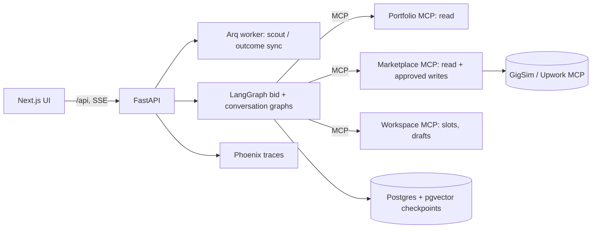

# GigBid: a multi-agent freelancer copilot

LangGraph agents scout freelance jobs, judge whether they are worth bidding on, write proposals grounded in portfolio evidence and handle client
messages. **A human approves everything that leaves the system.** Marketplace access goes through one port with two adapters (GigSim simulator,
official Upwork MCP), switched by config.

<!-- TODO(owner): 30-second demo GIF here -->

## Architecture

Generated graph diagrams: `docs/images/bid_graph.mmd`, `docs/images/conversation_graph.mmd`. Details: `docs/ARCHITECTURE.md`, tools: `docs/TOOLS.md`.

Bid graph: intake -> injection guard -> **parallel** Job Analyst / Risk Assessor / Fit Matcher -> decision -> pricing -> writer -> claim verification ->
critic (max 2 loops) -> compliance -> **human approval (`interrupt()`)** -> idempotent executor.

## Run it
```
cp .env.example .env        # fill secrets; `make preflight` checks them without printing values
make up                     # docker compose: web, api, worker, 3 MCP servers, GigSim, Postgres+pgvector, Redis, Phoenix
```
Web http://localhost:3000, API http://localhost:8000/docs, traces http://localhost:6006. Local without Docker and operations: `docs/RUNBOOK.md`.
Tests: `make lint test`. Open-weight models only (profile `open`); drafting needs `GROQ_API_KEY`, otherwise nodes run in deterministic template mode.

## Results (every number comes from a file in `evals/results/`)
**Shipped graph, 30 dev jobs, real models** (`ci_smoke_table.md`, the CI gate):

| decision accuracy | bid/skip F1 | scam bid rate | final unsupported claims / proposal | verified rate | p95 latency (s) |
|---|---|---|---|---|---|
| 0.9333 | 0.95 | 0.0 | 0.0 | 1.0 | 13.53 |

Final unsupported = 0.0 holds by construction after verification; the pre-verification figure is 0.05 per proposal (same file). Synthetic jobs and personas.

**RAG variants** (`rag_eval_table.md`, `rag_ablation_table.md`; offline stand-in embedder + lexical reranker, synthetic personas, so an upper-bound
style comparison, not real-world retrieval quality). The shipped design (`vbest` = decompose + hybrid + corrective) reaches recall@5 0.6588,
project-recall@5 0.692, MRR 0.983 versus the naive V0 baseline at 0.4441, 0.4576, 0.9542. Method and caveats: `docs/RD_B_results.md`.

**Claim verification** (`rag_verify_eval.json`): every planted fabrication is removed (recall 1.0); with retrieved evidence 83 to 92 percent of
truthful claims are kept. Precision is low (0.13 to 0.40) because evidence retrieval misses some true claims.

Pending real runs (cells stay empty until a file exists): multi-agent comparison (`make rdc`), tool granularity (R&D-A), X2 experiment (`make x2`),
three public trace links, latency/cost per proposal.

## Signature extension: X2 proposal experiments
`docs/EXTENSION.md`. Opener strategies are config data, assigned by hash(job_id), tested with a two-proportion z-test.

## Change request (GigSim policy update, 2 Nov 2026)
Rules, costs and prompts are data: `agent/policy/rules.yaml`, `agent/config.yaml`, `gigsim_local/policy_update.yaml`. See `docs/RUNBOOK.md` and
`docs/AI_USAGE.md`.

## Safety
Job posts and client messages are untrusted (quarantine, heuristics, Prompt Guard); PII is masked in logs; writes need a human-minted approval
token that the Marketplace MCP server verifies (fail closed); no scraping, polite rate limits; secrets only in the environment.

## Repository map
`agent/` graphs, nodes, policy, memory, security | `rag/` retrieval variants + claim verification | `mcp_servers/` portfolio, marketplace, workspace |
`apps/api` FastAPI | `apps/web` Next.js | `worker/` Arq | `gigsim_local/` simulator stand-in | `evals/` runners + results | `infra/` Docker | `docs/` ADRs, tools, runbook.
